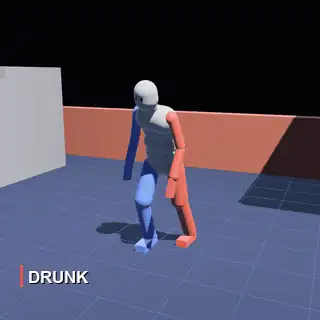
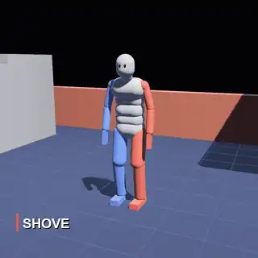

<h1 align="center">Delirium Physics: No Game Needed</h1>

  <b>The Delirium active-ragdoll playroom, running with no game files at all.</b> 
  No game assets required: nothing to own, nothing to find. Download it and play.

  
  

Everything above was filmed in this fork with no game files present.

> [!NOTE]
> **This is a modified fork of [Delirium Physics](https://github.com/PVCPC/delirium-physics)** (GPL-3.0-only), based on
> its 0.7.0 source. It is not the original and is not made or endorsed by its authors. The one change: the original
> needs files from a game you own to start, and this fork does not. What was changed, and how close the result is, is
> written up in [docs/no-game.md](docs/no-game.md).

## No game assets required

The original Delirium reads its numbers, its character, its animations and its weapon settings out of a game you
have to own. This fork ships its own stand-ins for all of them, so nothing has to be supplied:

| The original reads from the game | This fork uses instead |
|---|---|
| About 700 engine numbers | Our own table, worked out from Delirium's source and docs |
| The character (joints, limits, muscles, masses, shapes) | Our own stand-in body, measured from Delirium's own pictures |
| Get-up animations | Our own, generated with NVIDIA's Kimodo text-to-motion model and fitted to the body, with hands and feet planted on the floor |
| Idle, walk, run, sprint, gun and punch animations | Our own, hand-written key poses |
| Weapon and reaction settings | Our own estimates on top of the SDK's defaults |

**No game file, and no number taken from one, is in this repository, and none was looked at to make it.**

### What to expect

It is the real Delirium engine code running, on stand-in data. So, honestly:

- **Homer moves differently from the real Delirium.** Many of the numbers, and all of the masses, joint limits and
  muscle strengths, are estimates. He stands, balances, stumbles, recovers, falls and gets back up, but not exactly
  as he does with the game's data.
- **Checked here:** standing and balancing, shoves (a light one he rides out, a hard one floors him), getting up
  from his front and his back, drunk, stagger, electrocute, flinch, ice, being thrown by a blast, pistol damage.
- **Missing without the game:** the Hero's fight moves (there is one plain punch instead) and each weapon's own
  reaction settings.
- **Also seen working** (in the clips above): the wrecking ball and the high fall.
- **Not tested here:** grabbing, climbing, the other stages and Portal mode. The taxi did not appear in a quick try.
- **Want the real thing?** Point it at your own copy of the game exactly as the original does (`--game <folder>`).
  This fork still supports that, and then uses the game's data instead of the stand-ins.

## Play it

**Windows, ready-built (nothing to install)**

1. Download `delirium-no-game-<version>-windows.zip` from the latest [release](../../releases/latest).
2. Unpack it anywhere.
3. Double-click **`Play Delirium (no game).bat`**.

**Build it yourself**

1. Download this repository (green **Code** button → **Download ZIP**) and unpack it, or clone it.
2. Double-click **`Play Delirium (no game).bat`**. The first run builds the room, which takes a few minutes and needs
   [Rust](https://rustup.rs) and Microsoft's free C++ build tools. After that it starts in seconds.

Building by hand on any system: `cargo build --release -p delirium-room`, then run `target/release/delirium-room`
with no arguments. Only Windows has been tried with this fork.

## Open source: change it, improve it

Everything here is open source under the GPL-3.0, and the ready-built download is made from exactly the code in this
repository. You are welcome to fork it and make it better.

1. Click **Fork** at the top of this page, then clone your fork.
2. Change the code and rebuild with `cargo build --release -p delirium-room` (a few minutes the first time, quicker
   after).
3. Share it: open a pull request here, or publish your own fork. Keep the GPL-3.0 license, keep the source public,
   and say that your version is modified.

Good places to start:

- **The stand-in numbers** (`crates/delirium-data/src/kv-own.txt`): every line says how sure it is. About 270 are
  medium or low confidence, and better values make Homer move better.
- **The stand-in body** (`tools/make_character.py`): masses, joint limits and muscle strengths are estimates.
- **Animations** (`crates/delirium-room/src/getup.rs`): the get-ups, walk, run and punch. The Hero's fight moves are
  still missing.
- **The untested parts**: grabbing, climbing, the taxi, the other stages.

One rule to keep the project clean: **never add game files, or numbers taken out of them.** The point of this fork
is that it needs none.

## What Delirium is

A physics playground for an active ragdoll. Homer isn't animated. His muscles keep him standing, so he balances,
stumbles, braces, flails and falls on his own. Push him, shoot him, throw things at him, or step in as Hero.

Delirium is a reverse-engineered port of Euphoria, NaturalMotion's ragdoll and character physics engine, rewritten
in Rust by the [original project](https://github.com/PVCPC/delirium-physics). It comes with an
SDK (C, C++, C#, Python) and plugins for Unity, Unreal Engine 5 and Godot 4. Neither the original nor this fork is
affiliated with or endorsed by Rockstar Games, Take-Two Interactive or NaturalMotion.

## Controls

| | |
|---|---|
| **Click** | poke a body part |
| **Drag** | pull a body part around |
| **Shift + click** | shoot him |
| **1 / 2 / 3** (or Ctrl + point) | throw a ball, a box or a crate |
| **Right drag, wheel** | turn and zoom the camera |
| **[ / ]** | slower / faster (down to 1/16) |
| **Space** | pause |
| **R** | reset his pose |
| **X** | stop all behaviours |
| **H** | hide the panels |
| **F11** | fullscreen on / off |

Choose reactions under **Reactions** in the left dock. Every shortcut is listed under **Help** in the room.

**Hero mode** (the Hero button): **WASD** walk (Shift run, Ctrl sprint), **left click** punch, **1** fists,
**2–0** guns, **mouse wheel** next / previous weapon.

## For developers

- `crates/delirium`: the engine
- `crates/delirium-sdk`: the C API, bindings for C++, C# and Python, plugins for Unity, Unreal Engine 5 and Godot 4
- `crates/delirium-room`: the room
- `crates/delirium-data`: readers for the game's file formats, and the stand-in number table (`src/kv-own.txt`)
- `tools/`: this fork's own helpers (filming, the stand-in character, the Kimodo get-up pipeline)

Where the stand-ins live and how each was made: [docs/no-game.md](docs/no-game.md). The original's guides still
apply to the engine itself: [Modding: start here](docs/start-here.md), [How it works](docs/how-it-works.md),
[Modding](docs/modding.md). Those guides describe the original, including its game-files requirement for the SDK; this
fork changed the Playroom's start-up, and the SDK's requirement is described in [docs/no-game.md](docs/no-game.md).

Generating new get-ups needs your own [Kimodo](https://github.com/nv-tlabs/kimodo) install (see
[docs/no-game.md](docs/no-game.md)); the two in use are already built in.

## Credits and license

- **Delirium Physics** by its original authors: <https://github.com/PVCPC/delirium-physics>. All of the engine, the
  room and the SDK are theirs. This fork adds the no-game start-up and its stand-in data.
- **Get-up motions** were generated with NVIDIA's [Kimodo](https://github.com/nv-tlabs/kimodo) (model under the
  NVIDIA Open Model License; its text encoder is Meta's Llama 3) and then retargeted and planted by this fork's code.
- Third-party assets of the original: [CREDITS.md](CREDITS.md).

**GPL-3.0-only** (see [LICENSE](LICENSE)), the same as the original. If you share a changed version, keep that
license, pass on the source, and say that it is modified.
